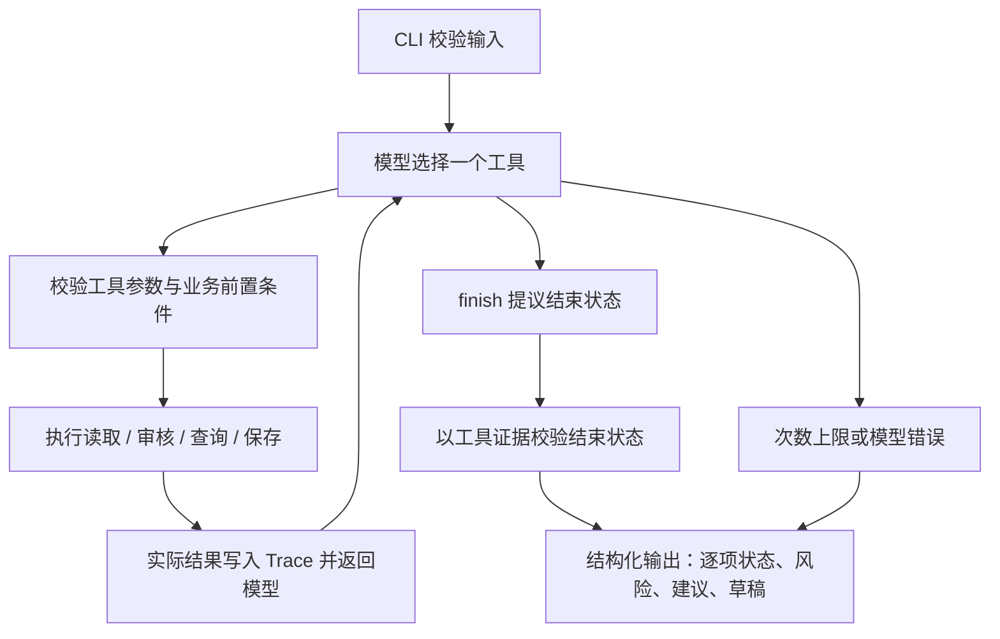

# 方案与技术取舍

## 调用流程

`agent.run` 仅负责有界循环、协议检查、执行和记录；它不根据“18:00 被占用”等业务事实自行选择下一工具。真实模式每轮由 Responses API 返回工具名称和参数，工具输出进入下一轮 `input`。如果服务一次返回多个调用，运行器拒绝整批执行，针对每个 call_id 返回 BATCH_REJECTED，由下一轮模型重新选择单个工具；拒绝轮次也计入执行上限。

工具 `finish` 也是模型主动选择的动作。其状态提议必须通过证据校验，例如没有保存成功记录就不能返回 completed。最终业务字段由工具状态生成，不直接采用模型自由文本，避免“已发布”“保存成功”等无依据陈述。

`MockProvider` 是独立的确定性测试策略，按工具输出分支；这些分支不是模型决策，不能作为 ReAct 达标证据。

## 模型可选择的工具

| 工具 | 关键输入 | 实际行为 |
| --- | --- | --- |
| read_material | source=base/supplement | 读取当前素材或补查，同时返回同请求已有草稿；使旧审核失效 |
| check_rules | 无业务参数 | 检查必要字段、授权状态、禁用词、人工复核项 |
| query_slots | mode=requested/alternatives | 查询用户指定/批准时段或同日替代窗口 |
| save_draft | slot | 重验审核与时段；自动判定确认状态；事务保存 |
| finish | status、suggested_slot | 验证结束状态依据并结束当前素材 |

所有工具都要求一条简短 `reason`，用于可读审计，不请求模型内部思维过程。工具不能指定其他素材 ID、写入用户确认、传入审核结果或自行构造数据库成功标记。

## 动态决策的预期路径

- 正常：读取 → 审核 → 查询指定时段 → 保存 → 观察保存成功 → finish。
- 冲突：查询指定时段发现不可用 → 模型查询替代时段 → 保存建议稿 → 观察待确认状态 → finish pending_confirmation。
- 信息不足：检查缺字段 → 模型选择补充读取 → 重新检查 → 成功继续或 needs_input。
- 工具失败：模型看到错误码与 retryable，可重新查询、有限重试或报告失败。运行器自身不自动重试业务工具。

把占用从 18:00 改成 18:00 和 19:00 后，替代结果应随实际查询改为 20:00。真实评估与离线评估共享输入和断言，但结果分别存储。

## 状态与存储

数据库唯一键 `(request_id, material_id)` 防重复；原始要求指纹用于发现复用 ID 的不同请求。确认是同一草稿的显式更新，故 `approved_slot` 不属于原始要求指纹。

`BEGIN IMMEDIATE` 取得 SQLite 写锁后，再次检查现有占位。`(platform, reserved_slot)` 的部分唯一索引提供第二道防线。只有 COMMIT 成功后工具才返回成功。保存前的查询不保证到写入时仍可用，发生竞争时返回 SLOT_CONFLICT 给模型重新决策。

`pending_confirmation` 草稿有 suggested_slot，没有 reserved_slot。用户确认后再次运行会更新同一行。已确认草稿不能通过重复请求更改时段；完整改期/撤销不在范围内。重复旧输入不能将 confirmed 降级。

每个请求共享模型调用上限，包含 finish、参数错误、失败调用；达到上限未完成的项显式报告，先前成功的结果保留。每个真实 API 请求超时 45 秒，无自动网络重试或 Mock 回退。

保存故障（故障注入或数据库写入错误）会返回 `retryable=false` 并阻断本次执行后续写入，由模型选择报告失败；用户可用相同 request_id 开始新一轮执行。时段竞争 SLOT_CONFLICT 不属于这类保存故障，仍允许模型查询替代时段。读取工具的暂时错误可以由模型选择重试。这样工具标记、提示词和执行约束保持一致。

## 为什么不用框架

核心保留五个工具与单 Agent 对照模式；双 Agent 额外提供两个受权限约束的交接动作。直接实现能使评审快速定位模型选择、工具观察、权限校验和事务边界，且离线运行没有依赖安装成本。没有采用第三方 Agent 框架，因而无框架版本或功能声明。

标准库 urllib 对接 Responses API；使用 strict 工具 schema、`parallel_tool_calls=false`、`tool_choice=required`，并把工具调用结果继续传回模型。实现参考 [OpenAI 官方 Function calling 文档](https://developers.openai.com/api/docs/guides/function-calling)（核对日期：2026-11-02）。`store=false`，连续上下文所需的模型响应项仅在内存保留；Trace 不持久化这些推理项。

DeepSeek 适配器使用同一个 Responses 工具循环，模型为 `deepseek-flash`，显式 `reasoning.effort=none`，不发送服务不支持的 `include`、`store` 或禁止并行参数。本地工具参数校验仍完整执行。DeepSeek 可能返回多工具提议，运行器通过上述有界纠正流程处理，不自行选择或执行其中一个动作。依据 [DeepSeek 官方 Responses 兼容说明](https://api-docs.deepseek.com/guides/responses_api/)（核对日期：2026-11-02）。

本机密钥由环境变量或 `--env-file .env` 读取；配置只允许服务声明的变量名，不执行 shell 表达式，错误消息不回显配置行。CI 仅运行离线测试，不加载密钥、不调用真实模型。

## 信任边界与局限

输入 JSON 代表本地运行者的授权，素材内容仅是资料，提示词要求忽略其中的指令。真正的保护来自工具参数白名单、授权字段隔离与写入前复核，而不是只依赖提示词。

规则检查是合成的精确字符串匹配，不是完整合规审核或语义风险识别。资料在启动时加载到内存；运行中的外部文件修改不会被实时监听，下一次 CLI 或 HTTP 任务开始时读取新文件。SQLite 并发保证只针对共享同一个数据库的实例，JSON 中的外部排期不具备跨系统事务能力。

## 双 Agent、上下文与运行器扩展

`--orchestration team` 启用两个具有独立角色指令、工具集合和短期对话上下文的模型 Agent，使用同一模型服务，串行协作。审核 Agent 可用 read_material、check_rules、handoff_schedule、finish；排期 Agent 可用 query_slots、save_draft、request_review、finish。模型即使输出角色外的工具，运行器也返回 ROLE_FORBIDDEN，不执行。单 Agent 的工具数量仍为 5，双 Agent 合计 7 个不同动作。

交接由模型选择 handoff_schedule 发起；运行器确认实际审核通过后，从 ToolContext 构造包含原始输入、素材、审核结果、已有草稿和错误的交接包。模型只能提供一句 reason，不能自行传入批准或审核事实。接收方从这个结构化包建立新 history，继续独立模型调用；不会复制上一角色全部对话。排期 Agent 可用 request_review 返回审核 Agent，循环仍受全请求共享预算约束。此双角色模式没有任务规划 Agent 或独立模型终审；结束状态由确定性工具证据校验，用户批准来自明确输入。

CLI 增加可选 max-total-tokens / max-seconds；网页固定为 60000 Token、180 秒，最多 48 次调用（默认 24）。Token 与时间预算在发起下一次调用前检查，是软预算，最后一个请求可能越过阈值；模型接口仍有 45 秒超时。没有中断在途模型请求、上下文摘要压缩或硬费用封顶。角色交接只携带结构化必要状态属于上下文隔离，不应描述成完整会话压缩。

HTTP 采用本机回环地址、Bearer 访问口令、Host/Origin 校验、固定静态资源白名单、32 KiB 请求体上限、单工作线程和最多 8 个排队/运行任务。最多缓存 100 个任务状态；已完成结果和 finalized Trace 事件保存在 .runtime/web。事件的 next_action 在下一步已知后落盘，因此强制退出可能缺少最后一个在途步骤；SQLite 草稿仍需以持久状态为准。重启后可读取已保存结果，只有请求而无最终结果的任务标记 interrupted，不会伪装成功或自动续跑。

没有持久任务队列、分布式锁、多租户鉴权或生产监控；这是增强后的本地运行器，不宣称生产级。网页所有模型文本使用 textContent 渲染，禁止注入 HTML。仅已登录本机口令的操作者可提交和确认；本机口令不是多用户身份系统。

## 跨天活动模式

新增独立 `campaign.py` 三角色运行器：规划、审核、排期，共 11 个动作。新增 `campaign_store.py` 提供 SQLite 检查点、120 秒租约与 revision 校验，`campaign_domain.py` 提供跨日候选和硬约束计算。新模式每轮重读资料，恢复复用有效步骤；旧模式仍按上述方式工作。完整交接契约、记忆/预算边界、确认与幂等见 [08-campaign-runtime.md](08-campaign-runtime.md)。没有 Skills 或 LangGraph；结构化交接也不是通用 Token 会话压缩。
