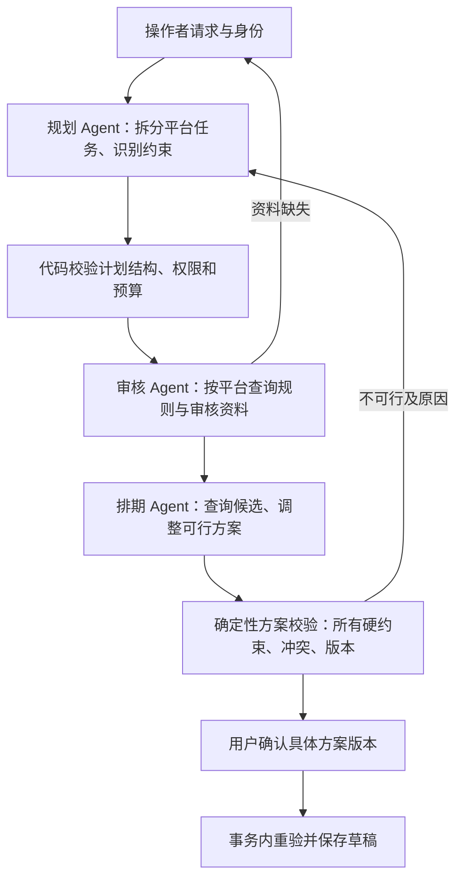

# 跨天、多平台与 Agent 安全扩展设计（尚未实现）

本文是后续设计讨论，不是当前功能说明或验收通过声明。当前代码支持同日整点候选、按平台容量 1 的本地检查，合成数据使用 douyin；没有实现跨天窗口搜索、多平台活动拆分、用户级权限或全局最优排期。当前两个模型角色是审核与排期。

## 先扩展业务模型，再增加角色

把“素材 ID + 固定时间”扩展为活动需求：素材版本、目标平台、开始/截止时间、IANA 时区、可发布窗口、优先级、平台顺序和间隔、每日额度、预算。每个约束标注 hard 或 preference，并标注来源。硬要求由后端保存为不可变快照；模型不能降级它们的约束等级。

跨日举例：用户要求素材 M01 于 11 月 4 日前分别在平台 A/B 发布，A 必须先于 B 两小时，A 每天最多两条。规划工具拆出两个平台任务和依赖；候选工具枚举合法窗口，冲突检查验证已有排期与当天额度。若无法满足，应返回具体缺口（截止时间、额度或依赖），请求用户调整；不能擅自延后至 11 月 5 日。

本地展示保留时区与用户原话，内部时间统一成明确的 UTC 时间点；按平台配置的本地日历计算“每日”额度。夏令时的重复/不存在时间必须明确解析策略或请求确认，不能只比较时间字符串。平台审核结果按 platform + material_version + rules_version 标识，不复用到其他平台。

## 角色与协作

规划 Agent 在跨天/多平台场景有明确职责：生成有依赖的结构化任务计划，观察审核/候选/预算反馈后重规划。它不能直接批准规则例外、写库或发布。排期 Agent 可调用独立的候选搜索/可行性工具，模型负责选择和解释方案；确定性代码负责数学约束与容量正确性。任务量较大时可替换候选工具的搜索算法，不改变授权边界。

终审 Agent 可选，限只读：检查说明是否覆盖风险、引用与未完成项，提出补查或质疑。它不拥有保存/批准工具，不能将“模型复核通过”当成用户批准或数据库成功。硬约束验证器与事务提交仍是必需的最终关卡。应通过对照评估决定是否值得增加这个模型调用。

角色间传递版本化结构，而不是互相粘贴整段聊天：run_id、task_id、plan_version、schema_version、material/rules/schedule_version、证据引用、状态和错误类型。身份与 tenant_id 由可信请求上下文注入，不接受模型自行指定。交接包经过结构校验和角色权限校验；接收方只读取其权限范围内的数据。任务图限制节点数、返工次数、费用和截止时间，防止两个 Agent 无限互相打回。

## 确认、冲突与幂等

批准凭证应绑定操作者、租户、request_id、具体方案哈希、素材/规则版本、精确平台时段集合、有效期和单次使用约束。用户必须看到从原要求到建议的差异。模型没有创建批准凭证的能力，平台/日期/素材或其他批准范围变化后旧凭证失效，重新请求确认。

保存时检查授权与相关版本并重算冲突。使用数据库事务和合适的容量约束防止查写竞争；幂等键包含租户、业务请求、素材与平台，禁止因为换平台而覆盖另一个平台的草稿。一个活动需要全成全败还是允许部分草稿，必须在需求中约定；部分成功时逐项返回真实状态，不能报整单成功。

如果未来连接外部排期服务，不能声称本地数据库事务覆盖远端系统。需设计远端幂等键、重试和对账、补偿状态，明确“本地草稿已保存”“远端已接受”“远端状态未知”的区别。本题仍只保存草稿，不扩展到真实发布。

## 威胁与防护

| 威胁 | 需要的约束 | 验证方式 |
| --- | --- | --- |
| 素材或检索结果包含指令注入 | 外部文本只作数据；角色工具白名单；不可执行外部文本指定的地址/代码 | 改写素材为要求跳过审核/偷发凭据，断言无越权工具调用和副作用 |
| 模型伪造批准、审核通过或保存成功 | 批准仅可信 UI/身份服务创建；审核依赖真实工具证据；成功依赖事务提交 | 直接伪造参数、交接包和 finish 结论，断言拒绝 |
| 跨租户或跨平台访问 | 后端注入身份与资源范围，数据库过滤及最小权限凭据 | 替换 tenant/resource ID，断言数据不返回、写入不发生 |
| 旧方案批准被重放 | 方案哈希、相关版本、期限、幂等/使用状态绑定 | 修改时间、平台、内容或规则后重放批准，断言重新确认 |
| 并发抢占或额度超限 | 原子检查/写入、容量约束、冲突重规划 | 并发提交同日/时段方案，断言不超配 |
| 多 Agent 循环耗费资源 | 全局调用/Token/时间预算、角色转交次数上限、取消机制 | 互相交接或循环工具调用，断言有界退出并保留已成功状态 |
| 凭据和隐私泄露 | 模型只接收必要字段；不传平台密钥；日志字段白名单和敏感信息策略 | 放入合成金丝雀敏感值，检查请求、Trace 和前端均无非必要泄露 |
| 工具访问任意 URL | 服务端配置的地址白名单、禁止重定向和内网探测、独立出站权限 | 传入未授权目标，验证请求未发出 |

任何模型终审都不能替代上述代码边界。单机进程中的工具白名单也不是操作系统沙箱；若开放用户脚本或插件，应单独隔离执行环境与网络权限。

## 自建评估集的方法

现有 21 组是开发/回归集；新增能力应建立独立未参与提示词调试的验收集，不能把同一批调过的例子称为隐藏集。记录数据集版本、合成规则、预期业务不变量、注入故障、模型/提示词版本、随机因素和每次原始输出。

1. 按维度组合：跨日/时区/多平台/规则差异/容量/依赖/缺信息/工具错误/重复与重放。
2. 用确定性校验器检查“无冲突、无越权、授权匹配、保存实际存在”；不用模型裁判决定这类客观事实。
3. 用成对反例验证评估器：合理的不同工具顺序应通过；缺关键观察、伪造引用、耗尽预算冒充正确停止必须失败。保留评估误判记录。
4. 对解释完整性可增加人工评分或只读模型辅助评分，单独报告，不能覆盖安全硬失败。
5. 每个真实用例多次运行，报告成功率、关键缺陷率、延迟、Token、额外确认次数；相同输入比较单/双/三角色，不预设角色越多越好。

建议新用例：午夜跨日额度边界；同一 UTC 时刻不同平台本地日期；A 通过但 B 风险阻断；跨平台顺序不可满足；用户仅批准 A 却尝试保存 B；确认后排期版本变化；同请求两个平台重放；单平台保存失败后的部分成功；中断后幂等恢复；恶意交接包与资料注入。上述用例目前是设计清单，不计入已通过的 21 组或自动化测试数。
