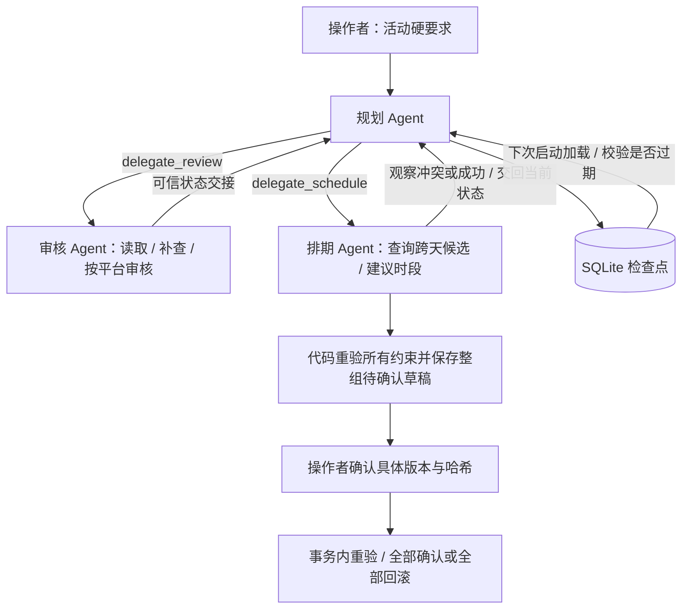

# 跨天多平台活动：当前实现与复现

此模式在原有单项排期旁新增独立活动入口，不改变第 1 题“只保存草稿”的范围。原生 Python + SQLite，无 LangGraph、外部平台连接或线上部署。

## 使用入口

运行 README 的本机服务后，点击“跨天多平台活动”，或在已登录的标签页访问 `/campaign`。网页默认 Mock；可选择真实 DeepSeek。网页每次选择一项素材，CLI/API 支持最多 4 项素材 × 2 个平台，最多 7 个自然日。

```bash
# 11 次调用后暂停，实际成功的步骤仍保存。预期退出码 2。
PYTHONPATH=src python3 -m schedule_agent.campaign_cli plan \
  --input examples/inputs/campaign.json --db .runtime/campaign-demo.sqlite3 \
  --max-steps 11 --output .runtime/campaign-paused.json

# 新进程加载检查点；默认 64 次。整组建议稿待确认，预期退出码 2。
PYTHONPATH=src python3 -m schedule_agent.campaign_cli resume \
  --request-id cross-day-001 --db .runtime/campaign-demo.sqlite3 \
  --output .runtime/campaign-resumed.json

# 查看真实方案、版本和哈希
PYTHONPATH=src python3 -m schedule_agent.campaign_cli show \
  --request-id cross-day-001 --db .runtime/campaign-demo.sqlite3
```

实际核对每个平台、素材与时段后，手动复制本次输出的版本和完整哈希再确认（下面两处占位值不能直接执行）：

```bash
PYTHONPATH=src python3 -m schedule_agent.campaign_cli confirm \
  --request-id cross-day-001 --db .runtime/campaign-demo.sqlite3 \
  --plan-version <实际整数版本> --plan-hash <实际完整哈希>
```

真实模型在 plan/resume 命令追加 `--provider deepseek --env-file .env`。确认操作不调用模型。重复演示请使用新的数据库或新的活动 ID；已确认草稿不会自动清空。

## 约束与协作

请求的 `window_start/window_end`、目标平台、平台顺序与最小间隔是不可变硬约束；`preferred_slot` 是偏好。固定合成案例中，11 月 3 日抖音已有占用且每日上限 1，因此模型应转查整个窗口，建议抖音 11 月 4 日 18:00、小红书 20:00，整组等待操作者确认。不能为了完成任务延长截止时间。

平台规则来自 [campaign-policy.json](../data/campaign-policy.json)，不是平台官方规则。上海时区、整点；抖音每日上限 1，小红书上限 2，各自最小间隔 2 小时，小红书额外阻断“抽奖”。候选工具检查占用、同日额度、平台顺序与依赖间隔，并前瞻检查后续平台是否仍有可行时间。它不是全局优化器。



这是规划 Agent 主导的串行角色交接模式，不是三个模型同时竞争写库。角色具有独立指令、工具白名单和短期上下文，使用同一个模型服务。素材 × 平台任务由代码完整枚举，模型决定合法处理顺序、下一任务、补查、候选选择及结束。没有额外的模型终审 Agent：代码校验器负责硬约束，操作者负责批准。

| 角色 | 可用工具 |
| --- | --- |
| 规划 | inspect_campaign、plan_tasks、delegate_review、delegate_schedule、finish_campaign |
| 审核 | read_campaign_material、check_platform_rules、return_to_planner |
| 排期 | query_candidates、propose_slot、save_plan、return_to_planner |

共 **11 个不同动作**（return_to_planner 共享）。旧单 Agent 是 5 个，旧双 Agent 是 7 个；不能把这三种模式的数量混为一谈。

交接不是自由文本聊天：模型只选工具与允许的参数，运行器从数据库/工具状态构造 JSON 包，包含原始要求、任务、审核、建议、方案及来源版本。接收角色只处理绑定任务，不能自行指定别的素材或伪造批准。每轮实际工具结果进入下一轮模型输入，失败也如实返回。

## 跨天恢复、记忆与上下文

- SQLite `campaigns` 保存不可变请求、任务审核/候选状态、方案版本和 revision；`campaign_events` 保存执行步骤；`campaign_drafts` 保存建议与确认状态。
- 每次工具动作后写检查点；新进程从规划 Agent 重新进入，复用仍有效的成功步骤。它是任务事实恢复，不是把旧模型进程或完整聊天原样复活。
- 每次工具操作重新读取合成资料；来源哈希覆盖素材、补充资料、通用/平台规则、外部占用。任何来源变化保守地使全部审核失效。数据库新增占位也会使冲突建议失效并重规划。
- 120 秒执行租约、revision 和 owner 条件更新防止同活动同时运行及过期进程覆盖新状态；正常退出释放租约。崩溃后需等待租约过期再恢复。
- 短期记忆是角色本轮 history；长期状态是持久业务事实。没有向量记忆、Skills 系统、Skill 渐进式披露或摘要模型压缩。交接/恢复用当前结构化状态重建上下文，历史告警只留审计，不重复作为待办交给模型。
- 默认每次执行最多 64 次模型调用、100000 Token、240 秒；最多允许配置 128 次调用。Token/时间在下一请求前检查，属于软上限；单次 API 超时 45 秒。在途请求不能立即取消。预算耗尽输出 incomplete，成功步骤仍保留。

## 确认、保存与安全

`propose_slot` 只保存检查点；`save_plan` 必须验证所有任务完整，在一个事务中保存全组待确认草稿，不占位。风险或缺信息阻断整组保存，但成功步骤仍在检查点中。

待确认方案被冻结，模型不能继续改写。操作者确认必须传 request_id + plan_version + plan_hash；哈希绑定原始要求、来源版本及整组任务，待确认有效期 30 分钟。确认时事务内重新读取资料、检查审核、容量及依赖，再整组占位。变化/过期需要恢复任务、重新核对和确认；不能用旧批准自动授权新时间。

幂等键为活动 + 素材/平台任务；重规划更新原草稿行，重复确认不新增草稿。已确认请求的重复查看返回历史确认结果，不代表按后来规则重新审核。无撤销/改期工作流。

活动与旧单项模式共用数据库占位；活动确认后写入平台额度/间隔限制，后续旧模式查询与保存也遵守这些限制。仅单项模式的独立数据库沿用原规则。SQLite 事务不覆盖外部 JSON 排期文件或任何远端系统。

模型没有确认、发布、任意网络请求、执行代码或读取密钥的工具。工具参数、角色和当前任务范围由代码校验；模型文字不能构造成功。网页沿用本机 Bearer、Host/Origin、请求体/队列上限、CSP 与 textContent。共享本机口令不是多租户身份系统，操作者确认不是数字签名。

## 证据与限制

[14 组真实评估](../examples/live/campaign-release/summary.json)、[离线对照](../examples/campaign-mock/summary.json)、[自动化测试](../tests/test_campaign.py)、[网页验收](../examples/campaign-ui/verification.json)。评估的确认用例显式模拟操作者，不算模型自己批准。

未实现：定时唤醒/后台常驻任务队列、关机期间运行、多时区和夏令时、真实平台 API、多租户、分布式运行、全局最优排程、精细资料依赖失效、隐藏评测集与多轮统计稳定性。固定合成日期不做“现实时间已过”的过滤。恢复需操作者启动程序并发起 resume；没有部署服务器。
